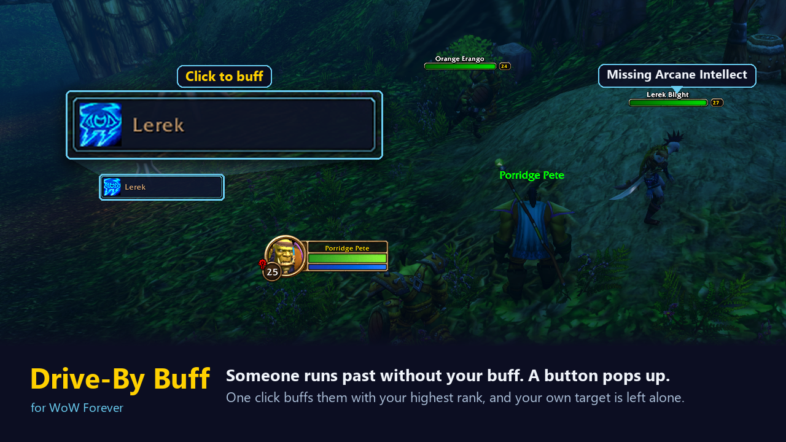
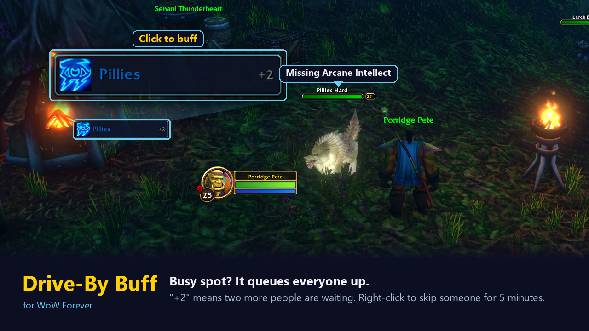
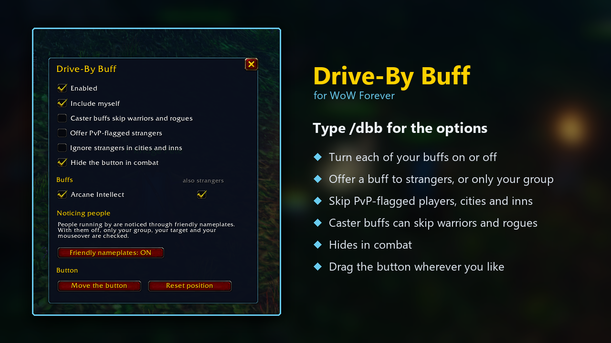

# Drive-By Buff

**For WoW Forever only.**

Like buffing strangers as they run past? Drive-By Buff pops up a button with the name of a nearby player who is missing one of your buffs. Click it and they get buffed. In a party or raid it keeps offering group members until everyone is covered.

## What it does

- Shows one button with the player's name (class-coloured) and the buff's icon.
- **Left-click** casts the buff on them and puts your own target back afterwards.
- **Right-click** skips that person for 5 minutes.
- Always uses the highest rank you know, and drops to a lower rank for low-level players.
- Skips anyone who already has the same or a better version of the buff, including the group-wide versions.
- If someone is missing two of your buffs, the button moves on to the second after the first lands.

## Supported buffs

| Class | Buffs |
|---|---|
| Mage | Arcane Intellect |
| Priest | Power Word: Fortitude, Divine Spirit, Shadow Protection (off by default) |
| Druid | Mark of the Wild, Thorns (group only by default) |
| Paladin | Blessing of Might, Wisdom or Kings, chosen by the target's class |
| Shaman | Water Breathing, Water Walking (both off by default) |
| Warlock | Unending Breath (off by default) |

Warriors, hunters and rogues have no buffs that are cast on another player, so the button stays hidden on those characters.

## Install

Download the latest zip, and extract the `DriveByBuff` folder into `World of Warcraft\_forever_\Interface\AddOns`. Restart the game.

## Setup

1. Type `/dbb` to open the options.
2. Turn on **Friendly nameplates**. This is how the addon notices people running by. Without it, only your group, your target and whoever your mouse is over are checked.
3. Shift-drag the button to where you want it.

## Options (`/dbb`)

- Turn each buff on or off, and choose whether it is offered to strangers or only your group.
- Include yourself.
- Caster buffs skip warriors and rogues.
- Offer PvP-flagged strangers (off by default, because buffing them flags you).
- Ignore strangers in cities and inns.
- Hide the button in combat.

## Good to know

- The game does not allow addons to change a cast button during combat, so the list only updates out of combat.
- One click is one cast. The addon never casts anything by itself.
- Mage is the most heavily tested class. If a buff misbehaves on another class, type `/dbb debug`, reproduce it, `/reload`, and include the `DriveByBuffDB` log from your SavedVariables in the report.

## Commands

- `/dbb` - open the options window
- `/dbb on` / `/dbb off` - turn the button on or off
- `/dbb plates` - toggle friendly nameplates
- `/dbb move` - show the button so you can drag it; again to lock
- `/dbb reset` - put the button back in the middle
- `/dbb debug` - toggle the debug log

## Screenshots

## Licence

MIT. See [LICENSE](LICENSE).
